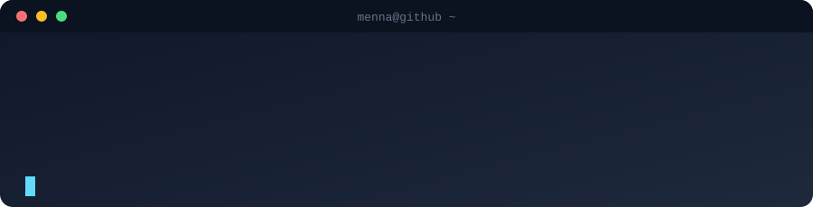
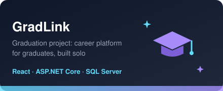
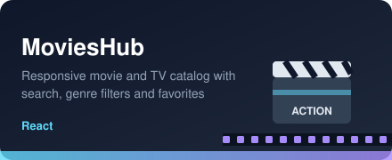
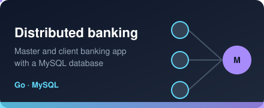

  

# Hi, I'm Mennatullah 👋

Software engineer focused on front-end development with **React.js**, with hands-on back-end experience in **C#, ASP.NET Core and SQL Server**. I graduated in 2026 with a Bachelor's in Computer and Information Science (Information Systems) from Assiut University.

  

  

  

## Projects

<table width="100%">
<tr>
<td width="50%"></td>
<td width="50%"></td>
</tr>
<tr>
<td width="50%"></td>
<td width="50%"></td>
</tr>
</table>

- **[GradLink](https://github.com/mennaa7med/GradLink)**: my graduation project, a full-stack career platform for graduates. I was the sole developer: a React.js front-end and an ASP.NET Core REST API with a SQL Server database.
- **[MoviesHub](https://github.com/mennaa7med/movie-site)**: a responsive movie and TV catalog in React with search, genre filters and a favorites list.
- **[Brew Morning](https://github.com/mennaa7med/coffee-site)**: a responsive multi-page coffee shop website built with React and React Router.
- **[Distributed banking system](https://github.com/mennaa7med/Distributed-System-Project-using-Golang)**: a master and client banking app written in Go with MySQL.

## Experience

- **Freelance Programming Instructor**: taught 300+ students C#, OOP, databases and web fundamentals.
- **Programming Instructor at Magnum Egypt**: taught Python to 50+ young learners through practical projects.
- **Backend .NET Intern at ITI**: worked with ASP.NET Core, C# and SQL Server.
- **Integration Developer Intern at Ejada**: completed training in enterprise applications and system integration.

## Problem solving

  

## Skills

React.js · JavaScript (ES6+) · HTML5 · CSS3 · Responsive Design · C# · ASP.NET Core · REST APIs · Entity Framework · SQL Server · MySQL · Go · Python · Git and GitHub

  

## Also studied (self-learning, not yet used in the projects above)

TypeScript · Next.js · Node.js · Express · REST API design · databases · authentication

  

I'm continuing with these, and applying them in projects next.
